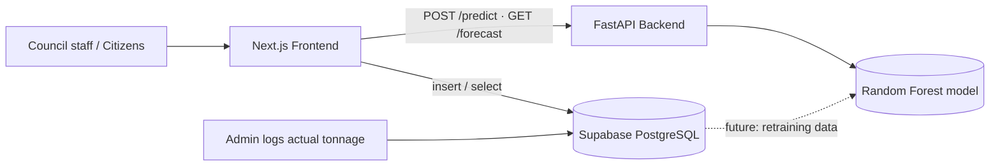

<div align="center">


# Kasala.lk (කසල.lk)

**Smart garbage collection demand prediction for Sri Lankan cities**

Predict how much waste each zone will produce, plan truck allocation ahead of demand spikes, and let citizens report problems — in English and Sinhala.

[](https://nextjs.org/)
[](https://www.typescriptlang.org/)
[](https://tailwindcss.com/)
[](https://fastapi.tiangolo.com/)
[](https://scikit-learn.org/)
[](https://supabase.com/)

[Live Demo](https://kasala-lk.vercel.app) · [Report a Bug](https://github.com/shehan-dev09/kasala-lk/issues) · [Request a Feature](https://github.com/shehan-dev09/kasala-lk/issues)

</div>

---

## Table of Contents

- [About the Project](#about-the-project)
- [Features](#features)
- [How It Works](#how-it-works)
- [Tech Stack](#tech-stack)
- [Project Structure](#project-structure)
- [The ML Model](#the-ml-model)
- [Getting Started](#getting-started)
- [API Reference](#api-reference)
- [Database Schema](#database-schema)
- [Internationalization](#internationalization)
- [Deployment](#deployment)
- [Known Limitations](#known-limitations)
- [Roadmap](#roadmap)
- [License](#license)

---

## About the Project

Most councils collect garbage on fixed schedules, regardless of what is actually happening on the ground. Weekends, Poya days, heavy rain, and population density all change how much waste a zone produces, so some areas overflow while other trucks run half-empty.

**Kasala.lk** (*kasala* = "waste" in Sinhala) predicts daily collection demand per zone so councils can plan ahead. It combines a trained machine-learning model, a live dashboard, an admin panel that logs real collection data, and a citizen reporting tool for overflowing bins and missed collections.

> **Transparency note:** there is no public real-time waste dataset for Sri Lanka. The model is currently trained on a *synthetic but grounded* dataset (published per-capita waste rates, official Poya calendar, documented multipliers). The admin panel collects real tonnage so the model can be retrained on real data. See [Known Limitations](#known-limitations).

---

## Features

- **Demand prediction** — pick a zone, date, and expected rainfall; get the predicted tonnage and a `LOW` / `MEDIUM` / `HIGH` demand level
- **7-day forecast chart** — rolling forecast per zone (Recharts)
- **Interactive zone map** — colour-coded demand markers for Colombo, Kandy, and Galle (Leaflet + OpenStreetMap)
- **Admin panel** — log actual collected tonnage to the database (the foundation of the feedback loop)
- **Citizen problem reports** — report overflowing bins or missed collections by zone and location
- **Bilingual UI** — English / Sinhala toggle, remembered across pages
- **Responsive design** — mobile, tablet, and desktop layouts
- **Branded landing page** — video hero, scroll animations, and a "how it works" section

---

## How It Works



**Prediction flow**

1. The user selects a zone, date, and rainfall on the dashboard.
2. The frontend sends the request to the FastAPI backend.
3. The backend builds the features (day of week, weekend, Poya day, season, previous volume, population), runs the model, and returns the predicted tons plus a demand level.
4. The dashboard shows the result and updates the map marker.

**Feedback loop (data collection)**

1. An administrator logs the actual tonnage collected.
2. The entry is stored in Supabase (`actual_collections`).
3. This real data is intended to retrain the model over time (see [Roadmap](#roadmap)).

---

## Tech Stack

| Layer | Technology |
|---|---|
| Frontend | Next.js (App Router), React, TypeScript, Tailwind CSS v4 |
| UI extras | Framer Motion, Lucide React, Recharts, Leaflet / React-Leaflet |
| Backend | FastAPI (Python) |
| Machine learning | scikit-learn (Random Forest Regressor), pandas, joblib |
| Database | Supabase (PostgreSQL) |
| Hosting | Vercel |
| Version control | Git & GitHub |

---

## Project Structure

```
kasala-lk/
├── ml/                          # Data generation and model training
│   ├── generate_data.py         # Builds the synthetic training dataset
│   ├── train_model.py           # Trains the Random Forest, saves .pkl files
│   └── requirements.txt
├── backend/                     # FastAPI prediction API
│   ├── main.py                  # /predict, /forecast/{zone}, /zones
│   ├── requirements.txt
│   └── model/                   # model.pkl + zone/season encoders
└── frontend/                    # Next.js web app
    ├── app/
    │   ├── page.tsx             # Landing page
    │   ├── dashboard/page.tsx   # Predictions, forecast chart, map
    │   ├── admin/page.tsx       # Log actual collection data
    │   ├── report/page.tsx      # Citizen problem reports
    │   ├── components/          # Header, Footer, ZoneMap
    │   ├── context/             # LanguageContext (EN / SI)
    │   ├── translations.ts      # All English / Sinhala strings
    │   ├── layout.tsx
    │   └── globals.css          # Tailwind theme (brand colours, fonts)
    ├── lib/supabase.ts          # Supabase client
    └── public/                  # Logo, hero video, images
```

---

## The ML Model

### Training data

The training set (`ml/generate_data.py`) simulates 365 days for each of three zones:

- **Population** per zone and a **per-capita waste rate** (about 0.55–0.75 kg/person/day, based on published national estimates)
- **Official 2026 Poya (full-moon) calendar** from the government gazette
- **Multipliers:** weekend (+15%), Poya day (+25%), heavy rain (−10%)
- **Autocorrelation:** each day depends partly on the previous day's volume
- Random noise for realism

### Model

| Item | Value |
|---|---|
| Algorithm | Random Forest Regressor (scikit-learn) |
| Features | zone, population, day of week, is_weekend, is_poya, rainfall (mm), season, previous-day volume |
| Target | waste volume (tons) |
| Evaluation | 80 / 20 train-test split |
| Result (initial run) | Mean absolute error ≈ 12.65 tons (about 2% for Colombo's ~560 t/day baseline) |

Zone and population dominate feature importance (they set each zone's baseline), followed by previous-day volume. Day-of-week, Poya, and rainfall have smaller but real effects.

### Demand levels

| Level | Rule (relative to the zone baseline) |
|---|---|
| `HIGH` | predicted volume > 115% of baseline |
| `MEDIUM` | between 95% and 115% |
| `LOW` | below 95% |

---

## Getting Started

### Prerequisites

- Python 3.10+
- Node.js 20+ and npm
- A free [Supabase](https://supabase.com) project

### 1. Clone

```bash
git clone https://github.com/shehan-dev09/kasala-lk.git
cd kasala-lk
```

### 2. Train the model

```bash
cd ml
python -m venv venv
# Windows: venv\Scripts\activate    macOS/Linux: source venv/bin/activate
pip install scikit-learn pandas numpy joblib

python generate_data.py     # creates synthetic_waste_data.csv
python train_model.py       # creates model.pkl + encoders
```

Copy `model.pkl`, `zone_encoder.pkl`, and `season_encoder.pkl` into `backend/model/`.

### 3. Run the backend

```bash
cd ../backend
python -m venv venv
# activate the venv as above
pip install -r requirements.txt
uvicorn main:app --reload
```

The API runs at `http://127.0.0.1:8000`, with interactive docs at `/docs`.

### 4. Set up the database

Create the two tables from [Database Schema](#database-schema) in your Supabase project, and add the row-level-security policies.

### 5. Run the frontend

```bash
cd ../frontend
npm install
```

Create `frontend/.env.local`:

```env
NEXT_PUBLIC_SUPABASE_URL=https://your-project-id.supabase.co
NEXT_PUBLIC_SUPABASE_ANON_KEY=your-publishable-key
```

In `frontend/app/dashboard/page.tsx`, set the backend address:

```ts
const API_URL = "http://127.0.0.1:8000"; // use your deployed backend URL in production
```

```bash
npm run dev
```

Open [http://localhost:3000](http://localhost:3000).

### Environment variables

| Variable | Where | Purpose |
|---|---|---|
| `NEXT_PUBLIC_SUPABASE_URL` | frontend | Supabase project URL |
| `NEXT_PUBLIC_SUPABASE_ANON_KEY` | frontend | Supabase publishable (anon) key |

> Never commit `.env.local`, and never put a Supabase `service_role` key in frontend code.

---

## API Reference

### `GET /zones`

Returns the supported zones.

```json
["Colombo", "Kandy", "Galle"]
```

### `POST /predict`

**Request**

```json
{
  "zone": "Colombo",
  "date": "2026-09-07",
  "rainfall_mm": 5
}
```

**Response**

```json
{
  "zone": "Colombo",
  "date": "2026-09-07",
  "predicted_waste_tons": 555.42,
  "demand_level": "MEDIUM"
}
```

### `GET /forecast/{zone}`

Returns a 7-day rolling forecast starting today.

```json
{
  "zone": "Colombo",
  "forecast": [
    { "date": "2026-09-07", "predicted_waste_tons": 555.42 },
    { "date": "2026-09-08", "predicted_waste_tons": 562.1 }
  ]
}
```

---

## Database Schema

```sql
create table actual_collections (
  id bigint generated always as identity primary key,
  created_at timestamptz default now(),
  zone text,
  collection_date date,
  actual_tons float8,
  notes text
);

create table problem_reports (
  id bigint generated always as identity primary key,
  created_at timestamptz default now(),
  zone text,
  description text,
  location_text text,
  status text default 'open'
);
```

Row-level security is enabled with **open insert and select policies for development**. Tighten these before real public use (see [Roadmap](#roadmap)).

---

## Internationalization

- Language state lives in a React context (`LanguageContext`) and is saved to `localStorage`, so the chosen language carries across pages.
- All UI strings live in `frontend/app/translations.ts` under `en` and `si` keys.
- Components read strings with `const t = translations[lang]`.
- To add a string, add the same key to both `en` and `si`.

---

## Deployment

| Part | Platform | Notes |
|---|---|---|
| Frontend | Vercel | Root directory `frontend`; set the two Supabase env vars |
| Backend | Vercel (Python / FastAPI) | Separate project with root directory `backend` |
| Database | Supabase | Hosted PostgreSQL |

**Gotchas worth knowing**

- Linux hosts are **case-sensitive**: `Logo.png` and `logo.png` are different files. Keep asset names identical to how code references them.
- The backend needs the trained `.pkl` files in the repository. Do not ignore them in `.gitignore`.
- The backend's scikit-learn version should match the version that trained the model.
- Include `https://` in the backend URL, otherwise it is treated as a relative path.
- Use `md:bg-fixed` instead of `bg-fixed` for parallax backgrounds, which render poorly on mobile.

---

## Known Limitations

- **Synthetic training data.** Predictions come from a model trained on grounded but simulated data, not real collection logs.
- **Forecast rainfall is a placeholder.** The 7-day forecast uses a fixed rainfall value, not live weather.
- **Recursive forecasting.** Each forecast day feeds the next, so accuracy drops later in the week.
- **No admin authentication yet.** `/admin` is publicly reachable; do not treat it as production-secure.
- **Open database policies.** Row-level security is permissive for development.
- **No automatic retraining yet.** Real data is collected, but the model is not yet retrained from it automatically.

---

## Roadmap

- [ ] Admin login with Supabase Auth, and stricter row-level security
- [ ] Rainfall field (or automatic historical weather) when logging collections
- [ ] Scheduled retraining on real data (GitHub Actions), blending synthetic and real data and publishing only if accuracy improves
- [ ] Live weather forecast (e.g. Open-Meteo) for the 7-day forecast
- [ ] Route optimisation and truck allocation suggestions per zone
- [ ] More cities and zones, with zone data moved into the database
- [ ] Photo upload for citizen reports, and a council view to resolve reports

---

## License

Distributed under the MIT License. Add a `LICENSE` file to the repository root to make this official.

---

<div align="center">

Built for a cleaner Sri Lanka 🇱🇰 by [@shehan-dev09](https://github.com/shehan-dev09)

</div>